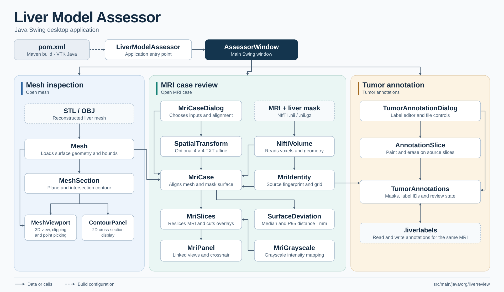

# Liver Model Assessor architecture guide

[Open the full-size architecture diagram](architecture.svg)

## What the app helps you do

Liver Model Assessor is a Windows desktop app for inspecting a reconstructed liver surface. You can open a 3D model from the reconstruction pipeline, cut through it visually, and measure it. If you also have the source MRI and a liver mask, you can inspect how the generated surface lines up with that mask. The same MRI case can be used to draw and save individual tumor annotations.

| What you want to do | Where to start | What you need |
| --- | --- | --- |
| Inspect the 3D model | **Open mesh…** | An STL or OBJ file |
| Compare the reconstruction with the liver mask | **Open MRI case…** | The mesh, source MRI, matching liver mask, and a known mapping from the mesh to the MRI coordinates |
| Draw or reopen tumor annotations | **Tumor annotations…** in an open MRI case | The open MRI case and, when reopening prior work, its `.liverlabels` file |

## How to read the diagram

Start at **LiverModelAssessor**, the application's entry point. It initializes VTK, the library that handles 3D geometry and image processing, and opens **AssessorWindow**, the main Java Swing window. Swing provides the desktop interface, including the buttons, dialogs, and panels.

The three colored columns are workflows inside that window. Solid arrows show a call or a handoff of information. The dashed boxes labeled **STL / OBJ** and **MRI + liver mask** represent files you open. The two-headed arrow next to `.liverlabels` shows that the app both reads and writes annotation files. The dashed arrow from `pom.xml` represents build configuration. Maven uses that file to assemble the app and its VTK dependency.

## Follow the three workflows

### 1. Mesh inspection

A **mesh** is the 3D shell of the reconstructed liver, made up of connected points and faces. The app opens that shell from an STL or OBJ file, then lets you rotate it, slice through it, and click points on its surface.

When you move the slice slider, the app moves an imaginary plane through the model. The line where that plane meets the surface is the **cross-section**. The 2D panel draws that line. Turning on **Clip 3D model** also hides one side of the plane in the 3D view, which makes it easier to inspect the cutaway.

The measurement panel shows the model's overall X, Y, and Z dimensions and the straight-line distance between two selected points. Readings start in **model units**, the units of the exported coordinates. If the exporter provides a known scale, enter the millimetres per model unit using **Set scale…**.

### 2. MRI case review

The **source MRI** is a stack of image slices. A **voxel** is one cell in that 3D stack, like a pixel with depth. The **liver mask** is a second 3D file that marks which voxels are part of the liver. The app treats zero as background and positive values as liver, then traces the boundary to create a reference surface.

1. **Open the case.** Choose the generated mesh, source MRI, and matching liver mask. The MRI and mask use NIfTI files (`.nii` or `.nii.gz`). Their spatial information tells the app where each voxel sits in 3D.
2. **Choose the mesh alignment.** If the mesh already uses the MRI's coordinates in millimetres, select that option. If the exporter used a different coordinate system, supply its **affine transform**, a small text file that describes the scale, orientation, and offset needed to place the mesh on the scan. If the mesh coordinates are unknown, the app can still display the MRI and liver mask alongside the standalone mesh.
3. **Check the overlay.** Review the gold mask outline and dashed teal mesh outline in the sagittal, coronal, and axial views. These are views sliced from the side, front, and top respectively. The pink crosshair marks the same position across all three. When mesh alignment is available, clicking the 3D surface can move the crosshair to the corresponding location in the MRI.
4. **Compare the surfaces.** Select **Confirm and compare** after reviewing the alignment. The app reports how far the generated surface and the mask-derived surface are from each other in millimetres.

**Reading the comparison.** The app measures from each vertex of one surface to the closest point on the other surface, then repeats this in the opposite direction. The **median** is the middle of those distances. The **95th percentile (P95)** is the distance at or below which roughly 95% of the samples fall. For example, if mesh → mask reports a P95 of 4 mm, roughly 95% of sampled mesh vertices are within 4 mm of the mask surface. The two directions can give different results because the surfaces may differ in shape and vertex density. Use the slice overlays to see where those differences occur.

### 3. Tumor annotation

Open **Tumor annotations…** from the MRI case. Create a label for each lesion you want to mark, then paint or erase its mask on the original acquisition slices. A single label can span several slices. Use **Show first marked slice** to return to the start of a saved mask.

Each label starts as **Draft**. The reviewer can mark a label **Reviewed** once it contains a mask. Editing that mask returns the label to **Draft** so the updated outline can be checked again.

The app saves the masks, label names, stable IDs, and review states in a `.liverlabels` file. Reopen that file with the same source MRI. The app checks a fingerprint of the MRI file and its grid dimensions so that the saved marks reopen on the intended voxels.

## Component reference for developers

The diagram shows the production classes in `src/main/java/org/liverreview`.

### Startup and mesh inspection

| Component | Responsibility |
| --- | --- |
| `pom.xml` | Defines the Maven build and declares the Windows VTK Java dependency. |
| `LiverModelAssessor` | Loads the native VTK libraries and starts the main window on Swing's event dispatch thread. |
| `AssessorWindow` | Coordinates file selection, viewer state, measurements, and review actions. Uses background workers for loading and surface comparison. |
| `Mesh` | Reads STL and OBJ geometry and exposes the model's bounds and point coordinates. |
| `MeshSection` | Owns the cutting plane and uses it to extract the intersection contour. |
| `MeshViewport` | Renders the 3D mesh, clipping, and overlays, and picks positions on the surface. |
| `ContourPanel` | Displays the 2D cross-section from the same cutting plane used in the 3D view. |

### MRI and surface comparison

| Component | Responsibility |
| --- | --- |
| `MriCaseDialog` | Collects the input files, alignment option, and confirmation of millimetres when NIfTI units are unspecified. |
| `NiftiVolume` | Loads a scalar 3D NIfTI volume. Reads its spatial transform, spacing, units, and slice order. |
| `SpatialTransform` | Reads or represents an affine transform, maps points between coordinate spaces, and computes the inverse mapping. |
| `MriCase` | Checks the declared NIfTI frame and spatial overlap, extracts the liver mask's reference surface, and prepares the aligned surfaces when a mesh transform is supplied. |
| `MriIdentity` | Records the MRI's SHA-256 file fingerprint and voxel grid dimensions. |
| `MriSlices` | Uses linear interpolation to sample MRI intensities in the three anatomical planes and cuts the mask and available mesh overlays at the same slice positions. |
| `MriGrayscale` | Maps MRI intensities to display shades in both the linked slice views and annotation editor. |
| `MriPanel` | Displays the linked MRI slices, overlays, and shared crosshair. |
| `SurfaceDeviation` | Uses VTK to compute unsigned vertex-to-surface distances in both directions and summarize each set with the median and P95. |

### Annotation editor and storage

| Component | Responsibility |
| --- | --- |
| `TumorAnnotationDialog` | Manages label selection, review state, and annotation file actions. |
| `AnnotationSlice` | Displays the original MRI acquisition slice and maps brush strokes to voxel positions on that slice. |
| `TumorAnnotations` | Stores labels and their per-slice voxel masks. Reads and writes the versioned, compressed `.liverlabels` format and checks that it matches the current MRI. |

### Coordinate details

The standalone mesh viewer works in the exported model's own coordinates. The MRI case uses **RAS+ in millimetres** as its shared physical space. RAS+ means the positive axes point toward the patient's right, front (anterior), and head (superior). The app uses the NIfTI sform when available and falls back to the qform. Those are two fields that can specify where the voxel grid sits in physical space. The optional mesh transform maps exported vertices into the MRI frame. Its inverse places MRI-derived geometry back into model coordinates for the standalone 3D view.

The annotation editor stores masks in the original MRI file's voxel grid. It accounts for any slice reordering performed by the NIfTI reader so that the slice a user paints is the same source slice identified in the saved mask.

## Where to go next

- Follow the [README](../README.md) to open files, use the controls, and build the desktop app.
- Consult the [V2 plan](../prototype%20V2.md) for the next milestone, which uses reviewed annotations for tumor counts and linked highlights.
