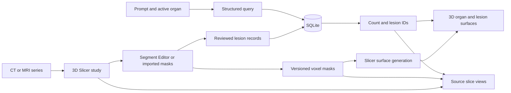
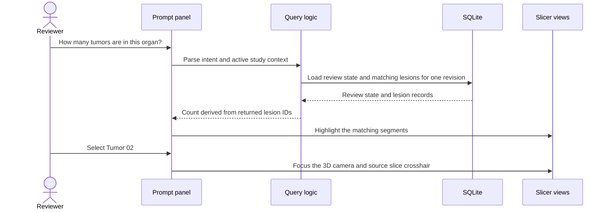

# CT/MRI Lesion Review

Implementation plan for Prototype V1

## 1. Goal and scope

Build a local 3D Slicer module that opens an organ model alongside its source CT or MRI, lets a reviewer save one annotation per lesion, and answers questions about those annotations. For **“How many tumors are in this organ?”**, return an exact count for the selected organ and study, highlight those same lesions in the 3D view, and link every result to its outline on the source images.

Use **one contrast-enhanced kidney CT** for the first end-to-end demo. Kidney CT is a planning choice because the organ and findings are concrete and annotated research data is available. Keep the data model modality-independent. Test the same workflow on an annotated MRI case as a separate compatibility milestone and record the formats and series tested.

V1 is a local, single-reviewer research prototype. Its answers come from saved, reviewed annotations. Automatic lesion detection, comparison across visits, and multi-user web access are later milestones.

### What the reviewer should see

| Action | Expected result |
| --- | --- |
| Open a study and choose **Left kidney** | See the selected scan and aligned 3D kidney. See the review state before querying. |
| Ask **“How many tumors are in this organ?”** | See **“2 reviewed tumor annotations in the left kidney”** for the demo case, with two matching entries and two colored 3D overlays. |
| Click **Tumor 02** | Focus the 3D camera and move the axial, coronal, and sagittal views to the same lesion. Show its outline on those slices. |
| Ask about a fully reviewed organ with zero tumor annotations | See **“0 tumor annotations in the reviewed left kidney.”** |
| Ask about an organ with incomplete review | See **“Review incomplete. 1 tumor annotation reviewed so far.”** The number reflects the current review progress. |

## 2. Architecture and stack

| Component | V1 choice | Implementation responsibility |
| --- | --- | --- |
| Desktop UI | 3D Slicer scripted module using Python and Qt | Study and organ selectors, review controls, prompt input, and results. Use Slicer's existing slice and 3D views. |
| Editing and rendering | Slicer Segment Editor and built-in segmentation-to-surface conversion | Author and revise masks, display slice overlays, and derive renderable surfaces. |
| Source data | One selected DICOM CT/MR series or a NIfTI volume | Keep the original input and the referenced series or file identity. |
| Annotation storage | Slicer segmentation file (`.seg.nrrd`) and SQLite | Keep voxel geometry in files. Store lesion identities, review state, and references in SQLite. |
| DICOM interchange | DICOM SEG when a compatible export or import is needed | Use source image references and verify the chosen Slicer extension with a paired scan and SEG fixture. |
| Existing STL | Optional organ model with a known transform into scan coordinates | Use the supplied model as display geometry after verifying alignment. Use the organ mask to generate a replacement surface when needed. |

Develop and test on the Windows workstation using one pinned Slicer release. Use the Extension Wizard to generate a Python module and use Slicer's bundled Python runtime for viewer integration. Keep the parser and SQLite access independent of Slicer so they can also run in standard Python tests. [Slicer Extension Wizard](https://slicer.readthedocs.io/en/latest/user_guide/modules/extensionwizard.html), [Slicer Python environment](https://slicer.readthedocs.io/en/latest/developer_guide/python_environment.html), [Segmentations and DICOM export](https://slicer.readthedocs.io/en/v5.12.0/user_guide/modules/segmentations.html)

## 3. Data model and persistence

| Record | Key fields | Purpose |
| --- | --- | --- |
| `study` | Internal study ID, modality, source series UID or file identity, source path, voxel-to-patient geometry | Resolve the selected source volume. Store the Frame of Reference UID when present. |
| `organ` | Organ ID, study ID, anatomy, laterality, organ segment ID | Scope the review and queries. Left and right kidney each get an organ record. |
| `annotation_revision` | Revision ID, organ ID, mask path, creation time, review coverage | Link all published records to one immutable mask file and record whether review is incomplete or complete. |
| `lesion` | Stable lesion ID, revision ID, source segment ID, display label, finding type, review status | Map each distinct finding to its geometry and carry the same lesion ID across ordinary mask edits. |

- Create one segment per lesion. A segment may span several slices or contain disconnected areas if the reviewer considers them one finding. Keep tumor, cyst, and indeterminate as separate labels. Represent an unreviewed shape as a draft.
- Use `draft`, `reviewed`, and `excluded` as lesion states. Count distinct IDs with `finding_type = tumor` and `status = reviewed` in the active revision. If a reviewer splits or merges a finding, save the revised identities and keep the earlier revision available.
- Store one current revision pointer per organ. Publish a revision by writing the mask to a temporary file, validating its segment references, and renaming it to the final path before committing the new records and pointer in one SQLite transaction. If saving fails, the previous revision stays queryable. If a mask file is missing, show a recovery message and withhold the linked query result.
- Scope each query and highlight to the same revision. After a study switch, reload, or saved edit, clear or rerun the query so a stale result cannot highlight another study or revision.
- Store imaging data outside version control. Use de-identified study data for development and demos. If you prepare your own DICOM fixtures, preserve the image-to-segmentation references when remapping identifiers and check for identifiers burned into the images. [DICOM confidentiality options](https://dicom.nema.org/medical/dicom/current/output/chtml/part15/sect_E.3.html)

## 4. Imaging and coordinate pipeline

1. **Load the source volume.** Let the reviewer select the intended DICOM series or NIfTI volume. Record its orientation, origin, and spacing or affine. For the CT pilot, use one series per case. Choose and record the specific MRI sequence for the compatibility test.
2. **Import or author masks.** Load the organ and lesion segments from a paired segmentation or draw them in Segment Editor. Preserve existing instance identifiers where supplied. A single class-level tumor mask requires a reviewer to confirm how it maps to individual lesions before counting.
3. **Verify geometry.** Compare DICOM references and frame information where available. A DICOM SEG can share a patient coordinate frame while having different voxel spacing or extent. Use the physical geometry to align the mask and source images. If conversion to the reference grid is required for a binary labelmap, use nearest-neighbor resampling and verify the result on slices. Reject a mismatched study or unresolved spatial transform. [DICOM Segmentation standard](https://dicom.nema.org/medical/dicom/current/output/chtml/part03/sect_A.51.html)
4. **Generate the 3D surfaces.** Derive a separate surface for the organ and each lesion. Render the organ translucent so internal lesions are visible. Keep the viewport linked to the underlying segment. An organ-only STL or point cloud can show the exterior anatomy. Internal tumor locations require source images with annotations or independently aligned lesion geometry.
5. **Verify any supplied organ model.** Record the mesh coordinate convention, units, and transform into the source scan's patient coordinates. Handle the LPS/RAS convention explicitly. Compare the imported surface against the organ outline on several source slices, including an asymmetric landmark that exposes orientation mistakes. Mark the paired-model workflow unavailable until a usable transform is established. [Slicer coordinate systems](https://slicer.readthedocs.io/en/v5.12.0/user_guide/coordinate_systems.html)
6. **Navigate to a result.** Store or derive a focus point inside each lesion mask in patient coordinates. Use an interior point so the view lands within the lesion even when its centroid lies outside a concave or fragmented mask. Convert to Slicer's world coordinates, center the slice crosshair, and frame the lesion in 3D. [Slicer segmentation scripting examples](https://slicer.readthedocs.io/en/latest/developer_guide/script_repository/segmentations.html)

## 5. Prompt and viewer behavior

Start with a small, deterministic parser for count and locate questions. Normalize plurals and supported wording such as **show**, **find**, and **where**. Treat **“this organ”** as the active organ. Match an explicit organ and side from the prompt against the active study. Ask for a side if two organs match an ambiguous request.

| Example prompt | Structured behavior |
| --- | --- |
| How many tumors are in this organ? | Count and highlight reviewed tumor annotations for the active organ. |
| Where are the tumors in the left kidney? | Select the left kidney if present, then list and highlight its reviewed tumor annotations. |
| Show the cysts | List and highlight reviewed cyst annotations for the active organ. |
| Show the biggest tumor | Display the supported questions. Add size ranking after validating volume measurements from the masks. |

Return the organ ID, revision ID, review coverage, and matched lesion records as one result. Calculate the displayed count from that list and reuse the same IDs for highlights. Show unsupported input, missing annotation data, and ambiguous anatomy as explicit states. Use a case-local query with parameter binding. A language model could later translate more varied prompts into the same typed filters, with the database still supplying the count and lesion IDs.

## 6. Implementation sequence

| Milestone | Build | Exit check |
| --- | --- | --- |
| **M0 · Establish reference cases** | Set up Slicer, choose a de-identified CT series, and record the expected lesions and their slice locations. Also make a small synthetic volume with known orientation, an asymmetric organ, two tumor masks, and a cyst. | Open the CT and synthetic cases in Slicer. Confirm the input series, expected findings, and reference slices. |
| **M1 · Visualize the anatomy** | Load the volume and organ segmentation, generate the organ and lesion surfaces, and wire result selection to the source slices. Add existing STL import with a verified transform if the pilot uses a supplied STL. | Two distinct internal overlays show through the organ surface. Each overlay aligns with its source mask on the expected slices. |
| **M2 · Persist review** | Add the SQLite schema, review and label controls, a save operation that publishes a consistent revision, and a reopen flow. | After restart, the same lesion IDs, labels, masks, links, and review coverage are restored. |
| **M3 · Connect prompts** | Add the count and locate parser, query service, results list, and synchronized highlighting. | The main prompt counts two reviewed tumors and highlights exactly those two. Selecting either row jumps to the corresponding source slices. |
| **M4 · Verify edge cases and package the pilot** | Run the test matrix, package the module, and write a short setup and demo guide. Run an annotated MRI compatibility pass when the paired fixture is available. | The CT demo runs from a fresh Slicer session using documented inputs. Record which CT and MRI input paths passed, with MRI status explicit if still pending. |

For public kidney CT data, KiTS23 includes kidney, tumor, and cyst annotations. Inspect the specific case and its annotation format before adopting it as a multi-lesion fixture. Use a verified fixture for zero-tumor coverage because KiTS23 was assembled around suspected renal malignancy. [KiTS23 dataset and cohort](https://kits-challenge.org/kits23/)

## 7. Verification and demo acceptance

| Scenario | Pass condition |
| --- | --- |
| Two reviewed tumors and one cyst | Count is two, exactly two tumor IDs are highlighted, and the cyst is excluded from that query. |
| One lesion spanning many slices or disconnected regions | One reviewed lesion ID contributes one count. |
| Two lesions close together | Two independently reviewed IDs remain separately selectable and contribute two counts. |
| Bilateral organs and incomplete review | Queries use the selected side. Completed zero and incomplete review produce distinct messages. Drafts are excluded from the reviewed count. |
| Alignment and source navigation | With an oblique or anisotropic fixture and an asymmetric landmark, all three slice planes agree with the labeled geometry. A representative internal lesion is visible in 3D and clicking it lands inside its mask. A mismatched study or unresolved mesh transform is rejected. |
| Save, edit, and reopen | Counts and highlights reflect the same saved revision. A simulated save failure preserves the previous revision. Missing geometry produces a clear error. |
| Annotated MRI compatibility | A selected MRI sequence loads, its paired mask aligns, and both count and slice navigation pass on the tested file type. |

Run fast Python tests for prompt interpretation, query filtering, and revision persistence. Use Slicer Self Tests for volume/segmentation loading and world-coordinate navigation. Finish with a manual review of the CT fixture and, when available, the MRI fixture. Check the expected lesion count and geometry against independently reviewed reference annotations. Record the Slicer version, fixture identifiers, expected counts, and pass or fail results so the demo can be repeated. [Slicer Self Tests](https://slicer.readthedocs.io/en/v5.12.0/developer_guide/modules/selftests.html)

## 8. After V1

- **Automatic lesion proposals.** Benchmark nnU-Net or MONAI on one organ and acquisition protocol using the source scans. Use a patient-level held-out set and report lesion-level sensitivity, false positives per study, count error, and mask overlap for matched lesions. Have reviewers confirm proposed lesion identities, including splits and merges. [nnU-Net](https://github.com/MIC-DKFZ/nnUNet), [MONAI](https://github.com/Project-MONAI/MONAI)
- **Browser review.** Evaluate OHIF and Cornerstone3D with Orthanc DICOMweb once local review works. Move structured queries behind FastAPI and use PostgreSQL when shared study metadata or concurrent review is needed. Preserve the lesion IDs and the link from each result to its source scan and mask. [OHIF](https://docs.ohif.org/), [Cornerstone3D](https://www.cornerstonejs.org/docs/getting-started/overview/), [Orthanc DICOMweb](https://orthanc.uclouvain.be/book/plugins/dicomweb.html)
