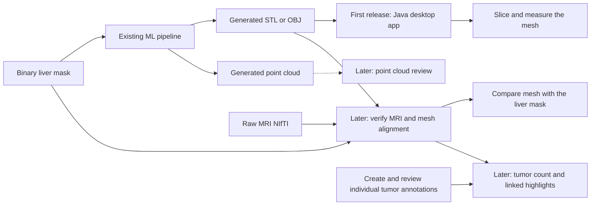

# Prototype V2 · Java Desktop Liver Model Assessor

## 1. Product scope

Build a standalone Windows desktop application in Java that opens the **STL or OBJ generated by the existing liver ML pipeline**. The first release focuses on **interactive mesh slicing and measurement**. A generated mesh is the only file needed to use it.

The existing pipeline takes a binary liver mask and generates a liver point cloud and a surface mesh. The available imaging data is raw **NIfTI MRI** and binary **liver masks**. Tumor annotations have yet to be created. The plan assumes Windows x64 for the desktop pilot. The mesh export's coordinate convention and physical scale still need verification.

### Release sequence

| Stage | Inputs | What the reviewer can do |
| --- | --- | --- |
| **First release** | One generated STL or OBJ | Orbit, pan, zoom, slice the mesh, see the cross-section, and measure two-point distances and overall dimensions. |
| **Later MRI assessment** | Generated mesh, raw MRI NIfTI, and its matching liver mask | Inspect the reconstruction against the liver mask and navigate corresponding MRI slices after verifying alignment. |
| **Later tumor review** | An aligned MRI case plus individual, reviewed tumor annotations | Count annotated tumors, highlight them in 3D, and jump to the corresponding MRI slices. |

## 2. Desktop layout and interactions

Use a main 3D viewport, a small 2D cross-section panel, and controls for opening models, changing the slice, and viewing measurements.

1. Open an STL or OBJ and reset the camera to frame the whole model.
2. Choose model X, Y, or Z and move a slice slider. The 3D view clips the mesh, and the 2D panel shows where the same plane intersects its surface. Use model-axis labels until patient orientation has been verified.
3. Click two points on the 3D surface to read their straight-line distance. Show the model's overall dimensions along X, Y, and Z. Display **model units** until the export's physical scale has been verified.

## 3. Recommended Java stack

| Part | Proposed choice | Implementation |
| --- | --- | --- |
| Desktop shell | OpenJDK 21, Swing, and Maven | Use a Swing frame with docked control panels and embedded VTK rendering. Package a Windows application image first. |
| 3D rendering and mesh IO | VTK Java bindings plus matching Windows x64 native libraries | Read STL and OBJ, pick points on the mesh, and drive clipping and cross-section contours from a shared plane. |
| Measurement | VTK mesh bounds and picked 3D positions | Calculate axis-aligned dimensions and two-point distances in the verified unit system. |
| MRI and liver mask display · later | VTK NIfTI reader and image reslicing | Load the available MRI and its paired mask, then draw linked slices and overlays after validating orientation and spacing. |
| Linked case data · later | Versioned JSON manifest and local files | Associate each reconstruction with its source MRI, liver mask, and coordinate transforms. Add SQLite when there are reviewed lesion records to query. |
| Windows packaging | `jpackage` | Ship a launcher, Java runtime, application jars, and the verified VTK native libraries. Test on a Windows machine without a developer setup. |

Make the first technical spike a packaged Java window that renders a supplied liver mesh. Pin the JDK and VTK versions together after checking JNI loading, interaction, resizing, and clean shutdown on Windows. Use Java for the application and keep the existing ML pipeline in its current environment. [VTK Java examples](https://examples.vtk.org/site/Java/), [Kitware Java bindings](https://www.kitware.com/vtk-the-polyglot/), [Oracle packaging overview](https://docs.oracle.com/en/java/javase/26/jpackage/packaging-overview.html)

## 4. Pipeline integration

### Open existing outputs first

- In the first release, open the generated STL or OBJ directly from disk. Record its path, file identity, coordinate convention, and units when known.
- For the later MRI workflow, add **Open Case** and a JSON manifest with the case and run IDs, the exact input liver mask, the generated mesh, its paired MRI, and the export-to-patient transform. Add point-cloud import after confirming the file format with a sample.
- Start MRI integration with one manually prepared manifest. Automate the handoff after a real paired case opens correctly.

### Keep geometry and scans in the same physical frame

Trace the export coordinate path from the input mask to each output. Capture crop, padding, resampling, axis ordering, centering, and scaling. Convert exported coordinates back to the input mask grid and then to the source scan's physical coordinates when the recorded transforms make that possible. Record both the scan voxel-to-physical mapping and the model-to-physical mapping. A mesh and point cloud may need separate transforms.

Verify alignment against the input liver mask on several slices and use asymmetric landmarks to catch a mirror, axis swap, or wrong offset. If a surface has known units but unknown patient alignment, it can still be measured in physical units. Keep the scan overlay unavailable until alignment is verified. For NIfTI, test how the reader exposes qform and sform and compose the mapping without applying spacing or orientation twice. Resample labels with nearest-neighbor interpolation when needed. [VTK NIfTI reader](https://vtk.org/doc/nightly/html/classvtkNIFTIImageReader.html), [VTK image reslicing](https://vtk.org/doc/nightly/html/classvtkImageReslice.html), [NIfTI coordinate systems and affines](https://nipy.org/nibabel/coordinate_systems.html)

## 5. Assess the generated model

| Feature | Implementation and expected result |
| --- | --- |
| **Clip and cross-section** | Use the same plane for clipping the visible model and cutting its intersection contour. Moving the slider updates both views. An open mesh can produce incomplete contours. [VTK cutter](https://vtk.org/doc/nightly/html/classvtkCutter.html) |
| **Dimensions and two-point distance** | Show bounding dimensions and a straight-line distance from the actual picked positions. Clicking empty space leaves the measurement unchanged. Apply the verified physical scale when reporting millimetres. |

Keep results tied to the imported mesh version. Plan area, enclosed volume, and topology diagnostics as follow-on features. For enclosed volume, require a validated closed, consistently oriented surface. [VTK mass properties](https://vtk.org/doc/nightly/html/classvtkMassProperties.html)

## 6. Later MRI assessment and tumor review

1. **Load a paired MRI case.** Open one source NIfTI MRI, its liver mask, and the generated mesh. Once the geometry is verified, show the MRI in three anatomical planes with the liver outline and a shared crosshair. [VTK image reslicing](https://vtk.org/doc/nightly/html/classvtkImageReslice.html)
2. **Compare the mesh with its input mask.** Generate a reference surface from the liver mask. Show both surfaces in 3D and on the same MRI slices. Record their distances in both directions in millimetres when the physical mapping is known.
3. **Establish a tumor annotation workflow.** The existing liver masks describe liver anatomy. To add tumor review, have a reviewer create individual tumor outlines on the MRI. One proposed route is to add a slice annotation tool to the Java app. An import route also works if reviewed annotations become available from elsewhere. Store a persistent ID and mask for each lesion.
4. **Connect the prompt after annotations are available.** Use the same reviewed lesion IDs for the count, result list, and 3D highlights. Selecting a result moves the MRI crosshair to a point inside its mask. A case without annotations or completed review shows **“Tumor review pending.”**

## 7. Build order and acceptance

| Milestone | Build | Acceptance |
| --- | --- | --- |
| **M0 · Java render and packaging spike** | Run a Swing/VTK test window, load one real pipeline STL or OBJ, package it for Windows. | The packaged app opens the mesh on a clean Windows machine. Rotate, zoom, resize, and close without native library or rendering errors. |
| **M1 · First release** | Implement mesh import, clipping, the 2D contour, dimensions, and two-point distance. | A synthetic cube gives the expected contour and dimensions. A pair of known points gives the expected distance. The packaged app opens and slices a real liver mesh with the correct unit label. |
| **M2 · MRI and mask comparison** | Load a paired NIfTI MRI, liver mask, and mesh. Add alignment checks and the reference surface comparison. | A synthetic case with known offset and anisotropic spacing detects coordinate mistakes. A real case has verified overlay in three planes. |
| **M3 · Tumor annotations** | Create or import individually reviewed tumor annotations from an MRI case. | A reviewer can reopen a case and match each stored lesion ID to its outline on the source slices. |
| **M4 · Tumor prompt and overlays** | Add the prompt, result list, 3D highlights, and MRI navigation. | A case with two reviewed tumors gives two exact highlights and correct slice locations. Test a pending review, a reviewed zero case, and save/reopen. |

## 8. Sample for the first build

One representative STL or OBJ from the existing pipeline is enough to start the Java viewer. Include its export units if known. Keep a matching de-identified MRI NIfTI and the exact liver mask used by the pipeline for M2.
